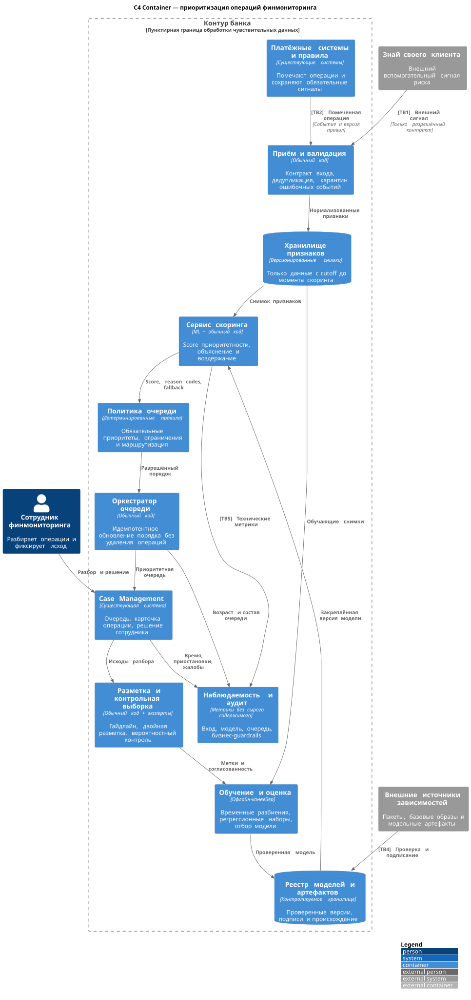
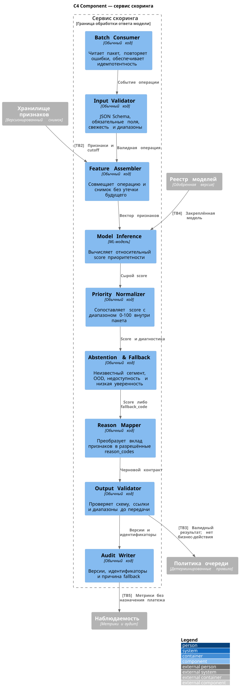

# Архитектура флагманского сервиса

## 1. Принцип и границы

Сервис меняет порядок разбора уже помеченных операций. Он не подтверждает схему, не отменяет операцию и не заменяет действующие правила. Модель ограничена вычислением относительной приоритетности; входная и выходная валидация, обязательные приоритеты, маршрутизация и действия сотрудника детерминированы.





Пунктирные Boundary показывают границы контура и сервиса. Метки `[TBn]` на связях соответствуют таблице угроз в разделе 8.

## 2. Ответственность компонентов

| Компонент | Тип | Ответственность | Чего не делает |
|---|---|---|---|
| Приём и валидация | Обычный код | Схема события, дедупликация, полнота, карантин, версия правил | Не удаляет обязательную операцию и не интерпретирует схему |
| Хранилище признаков | Данные + обычный код | Снимки с cutoff, версии, контроль свежести и происхождения | Не подставляет будущие исходы в обучение |
| Model Inference | ML | Относительный score по закреплённой версии модели | Не возвращает вероятность мошенничества и не выполняет действие |
| Priority Normalizer | Обычный код | Сопоставление score со шкалой 0–100 внутри расчётного пакета | Не калибрует и не называет score вероятностью |
| Abstention & Fallback | Обычный код | Воздержание, fallback_code и сохранение исходного порядка | Не скрывает сбой и не назначает низкий приоритет при неизвестности |
| Reason Mapper | Обычный код | Только предусмотренные объяснения и ссылки на признаки/правила | Не генерирует свободный текст с чувствительными данными |
| Политика очереди | Обычный код | Обязательные сигналы, регламентные ограничения, разрешённый порядок | Не принимает решение о клиенте |
| Оркестратор очереди | Обычный код | Идемпотентное обновление, повторы, восстановление исходного порядка | Не перезаписывает исход операции |
| Case Management | Существующая система | Рабочее место и фиксация решения сотрудника | Не передаёт модели полномочия сотрудника |
| Разметка и контрольная выборка | Обычный код + человек | Гайдлайн, независимая разметка, случайный контроль | Не смешивает эскалацию и подтверждённую схему |
| Обучение и реестр | Офлайн-код | Воспроизводимый отбор, подпись и закрепление версии | Не обновляет прод автоматически по свежим данным |

Retrieval, LLM, генерация текста, инструменты и графовая нейросеть не добавлены: постановка — табличное ранжирование с дополнительными текстовыми признаками. Калибровка вероятности также не требуется, пока выход не интерпретируется как вероятность.

## 3. Режим обработки и повторы

- Новые помеченные операции обрабатываются асинхронными микропакетами. Целевой интервал пилота — 15 минут; это проектное допущение, подлежащее согласованию с регламентом.
- Обязательные срочные правила продолжают работать в исходной системе и не ждут модельного пакета.
- Ключ идемпотентности: `(operation_id, feature_snapshot_id, model_version)`. Повтор не создаёт вторую операцию и не меняет исход разбора.
- При повторном скоринге сохраняется новая запись расчёта и ссылка на предыдущую; история не перезаписывается.
- При недоступности сервиса очередь использует последний валидный порядок или исходный порядок правил. Операции не исчезают.

## 4. Выходной контракт

```json
{
  "schema_version": "1.0",
  "operation_id": "op_123",
  "priority_score": 87,
  "priority_band": "high",
  "reason_codes": ["AMOUNT_DEVIATION", "COUNTERPARTY_CHAIN"],
  "source_refs": ["rule:R-17:v42", "feature_snapshot:fs_2026_001"],
  "model_version": "catboost_2026_01",
  "feature_snapshot_id": "fs_2026_001",
  "scored_at": "2026-01-01T12:00:00Z",
  "fallback_code": null
}
```

Правила контракта:

| Поле | Обязательность и проверка |
|---|---|
| `operation_id` | Обязателен; должен соответствовать входной операции |
| `priority_score` | Целое 0–100 либо `null` при fallback; не вероятность |
| `priority_band` | Только `high / medium / low / fallback` по версии политики |
| `reason_codes` | Только коды из версионированного справочника; пустой список допустим при fallback |
| `source_refs` | Ссылки на правила и снимок; никаких свободных чувствительных значений |
| `model_version`, `feature_snapshot_id`, `scored_at` | Обязательны для воспроизводимости |
| `fallback_code` | Обязателен при `priority_band=fallback`; причина машиночитаема |

Ответ проходит JSON Schema, проверку диапазонов, ссылок, версии модели и срока свежести до вызова политики очереди. Невалидный ответ не попадает в бизнес-действие. При отсутствии признаков модель не додумывает значения: сервис возвращает fallback и исходная очередь сохраняется.

## 5. Уровень автоматизации

| Действие | Исполнитель |
|---|---|
| Вычислить score и показать объяснение | Модель и сервис |
| Применить обязательный сигнал и регламентный приоритет | Детерминированные правила |
| Изменить порядок разрешённой части очереди | Сервис после валидации |
| Разобрать операцию, эскалировать, приостановить или снять приостановку | Сотрудник по действующему регламенту |
| Подтвердить схему и сформировать регуляторный вывод | Установленный процесс банка, не модель |
| Изменить модель, порог или гайдлайн | Отдельный контролируемый релиз с регрессией |

Пороги полос определяются ёмкостью разбора и ценой двух ошибок, а не желанием максимизировать эскалации. Высокий приоритет не увеличивает автоматическое право блокировки; низкий не отменяет обязательную проверку.

## 6. Fallback

| Наблюдаемый признак | Действие |
|---|---|
| Отсутствие, просрочка или невалидность признаков | `FEATURES_UNAVAILABLE`; исходный порядок, человек видит причину |
| Клиент/сегмент без достаточной истории | `NO_HISTORY`; не присваивать искусственно низкий приоритет |
| Значение за пределами обучающего диапазона, новый текст или высокий OOD-сигнал | `OUT_OF_DISTRIBUTION`; текущие правила и отдельный мониторинг |
| Score в заранее зафиксированной зоне воздержания | `ABSTAIN`; сохранить исходный или регламентный приоритет |
| Расхождение с обязательным сигналом правила | Обязательный сигнал побеждает; `RULE_OVERRIDE`, расхождение идёт в анализ |
| Недоступность модели, реестра или хранилища признаков | `SERVICE_UNAVAILABLE`; последний валидный/исходный порядок |
| Невалидный ответ или неизвестный reason code | `INVALID_OUTPUT`; отбраковка ответа до политики очереди |
| Таймаут, превышение лимита пакета или внешнего сервиса KYC | `TIMEOUT` / `LIMIT_EXCEEDED`; внешний сигнал не выдумывается |

Зона воздержания и OOD-пороги настраиваются на validation-наборе до пилота. Они не считаются известными заранее.

## 7. Мониторинг и откат

| Уровень | Сигналы | Реакция |
|---|---|---|
| Вход | Полнота и задержка событий, пропуски, диапазоны, версии правил, доля новых категорий и текстов | Карантин ошибочных событий, fallback, владелец данных |
| Модель | Распределение score, fallback/OOD по сегментам, стабильность признаков, задержка CPU, версия | Запрет релиза или откат на предыдущую модель |
| Очередь | Возраст, состав первых 10 тыс., SLA, доля rule override, время ожидания | Возврат к исходному порядку при ухудшении |
| Человек | Время разбора, согласованность, исправления маршрута, нагрузка на сотрудников | Пересмотр гайдлайна, интерфейса и полос приоритета |
| Бизнес | Снятые приостановки и жалобы на сопоставимый поток, эскалации как диагностика | Остановка пилота при ухудшении guardrail |
| Отложенное качество | NDCG и recall на новых экспертных метках, в том числе контрольной выборке | Повторная проверка, дообучение только через новый релиз |

Технический откат — закрепление предыдущей модели или полное отключение модельного порядка. Данные и исходы при этом сохраняются. Пороги технических алертов устанавливаются после shadow-наблюдения; бизнес-guardrails привязаны к измеренной базе, а не к произвольной точности.

## 8. Угрозы на границах доверия

| Граница | Угроза | Что делаем |
|---|---|---|
| **TB1:** внешний KYC → приём | Недостоверный/просроченный сигнал, компрометация канала, чрезмерное доверие | TLS и взаимная аутентификация, схема и свежесть, минимальный набор полей; сигнал только вспомогательный, итоговая оценка остаётся у банка |
| **TB2:** платёжные системы/признаки → сервис | Неполные события, подмена идентификатора, утечка будущего, несовместимая версия | Service-to-service авторизация, схема, уникальность, cutoff, версии и карантин; операция остаётся в обязательной очереди |
| **TB3:** модельный ответ → политика очереди | Prompt injection неприменим, поскольку LLM отсутствует; возможны подделка ответа, невалидный score, неизвестный код и превышение полномочий | Считать ответ модели недоверенным; JSON Schema, allowlist кодов, подписанная версия, отдельная детерминированная политика, ноль прямых клиентских действий |
| **TB4:** зависимости/модель → реестр и прод | Вредоносный пакет, базовый образ или веса, незаметная подмена версии | Закрытый реестр, проверка происхождения и уязвимостей, хеши и подпись, review, воспроизводимая сборка, регрессия перед релизом |
| **TB5:** сервис/очередь → наблюдаемость | Утечка банковской тайны и персональных данных через логи и метрики | Только идентификаторы и агрегаты, маскирование, запрет сырого назначения, RBAC, ограниченное хранение и аудит доступа |

Дополнительно внутри контура действуют минимальные права сервисных учётных записей, разделение ролей разметчика и владельца релиза, шифрование хранения и аудит выгрузок. Сотрудник видит только данные, необходимые для его текущей задачи.
